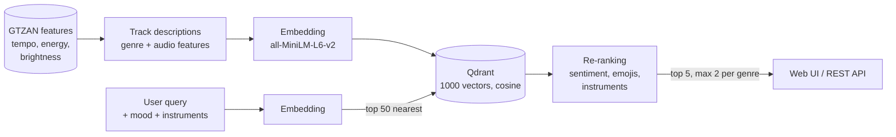
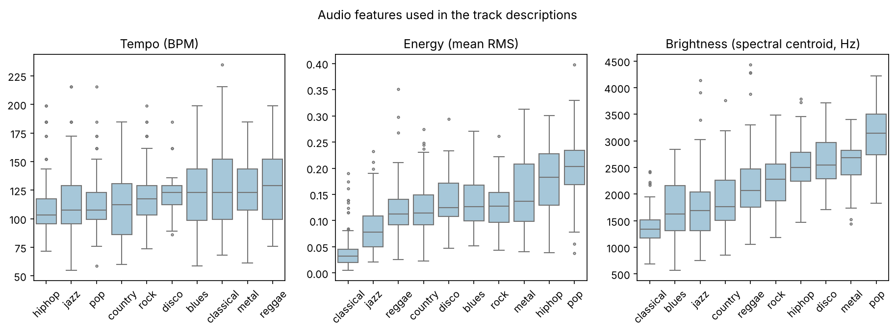

# Music Recommender with Qdrant

A semantic music recommender: describe the music you want in plain English ("a calm, sad song with piano for a rainy evening"), optionally pick a mood and instruments, and the app returns matching tracks from the [GTZAN](https://www.kaggle.com/datasets/andradaolteanu/gtzan-dataset-music-genre-classification) dataset. Track descriptions are embedded with a sentence-transformer model and searched in the **Qdrant** vector database; the results are re-ranked with the sentiment of the query.

**Stack:** Python · Qdrant · sentence-transformers (`all-MiniLM-L6-v2`) · TextBlob · Flask · Bootstrap · pandas · pytest

<!-- TODO: add a screenshot of the web app, e.g. docs/app.png -->

---

## How it works



1. **Descriptions.** GTZAN has no text, so every track gets an English description built from its genre and three audio features from `features_30_sec.csv`: tempo, energy (mean RMS) and brightness (spectral centroid), bucketed into terciles. Example: *"Sad blues song with soft tones and a slow pace. Slow tempo (about 63 BPM), steady, with a warm, mellow sound."*
2. **Indexing.** The descriptions are embedded (384 dimensions) and stored in Qdrant with the genre, file name and path as payload.
3. **Search.** The query is embedded the same way and the 50 nearest tracks are retrieved by cosine similarity.
4. **Re-ranking.** Sentiment (keywords, emojis and TextBlob polarity), the selected emojis and instruments add small boosts per genre, e.g. a sad query boosts blues, jazz and classical and pushes down metal and hip-hop. The results are sorted by the adjusted score and limited to two tracks per genre for variety.



---

## Getting started

```bash
git clone https://github.com/antonela-kovic/music-recommender-qdrant.git
cd music-recommender-qdrant
python -m venv .venv
source .venv/bin/activate        # Windows: .venv\Scripts\activate
pip install -r requirements.txt
python api.py                    # http://127.0.0.1:5000
```

On the first start the app indexes the 1000 tracks (the embedding model is downloaded once, about 90 MB).

**Qdrant.** Without configuration the app uses a local Qdrant database in `./qdrant_storage`, so no account or server is needed. To use Qdrant Cloud or a Qdrant server, copy `.env.example` to `.env` and set `QDRANT_URL` and `QDRANT_API_KEY`. `python index_data.py` rebuilds the index.

**Audio playback (optional).** The audio files are not in the repository (about 1.2 GB). Download the GTZAN dataset and put the `genres_original` folder into `data/`; the web app then shows an audio player for every result.

## REST API

`POST /recommend`

```json
{"description": "relaxed jazz with saxophone", "emotions": ["😌"], "instruments": ["saxophone"], "k": 5}
```

Response (shortened, values illustrative):

```json
{
  "sentiment": "positive",
  "recommendations": [
    {"filename": "jazz.00012.wav", "genre": "jazz", "description": "...", "similarity": 0.61, "score": 0.91, "audio_url": "/audio/jazz/jazz.00012.wav"}
  ]
}
```

`POST /reindex` rebuilds the index; `GET /audio/<genre>/<file>` serves an audio file when the audio folder exists.

## Testing

```bash
pytest -v
```

The tests use an in-memory Qdrant and a small word-hashing encoder instead of the neural model, so they run offline in a few seconds. They cover the description builder, indexing, retrieval, re-ranking order, the per-genre limit, sentiment detection and the API validation.

## Dataset plots

`python visualization.py` saves the plots to `docs/`: tracks per genre, audio features per genre (above) and the feature correlation matrix.

## Project structure

```
├── api.py              # Flask web app and REST API
├── recommender.py      # descriptions, Qdrant indexing, search and re-ranking
├── index_data.py       # rebuilds the Qdrant index
├── generate_csv.py     # builds data/gtzan_data.csv from the audio folder
├── visualization.py    # dataset plots
├── templates/index.html, static/style.css
├── data/               # gtzan_data.csv (track list), features_30_sec.csv (GTZAN features)
├── docs/               # plots
└── tests/
```

## Limitations

- The descriptions are generated from the genre and three audio features, not from listening data or lyrics, so the recommender matches the *described character* of a track rather than personal taste.
- The genre boosts are hand-tuned; an evaluation with user feedback would be needed to tune them properly.

## Data

GTZAN Genre Collection (G. Tzanetakis and P. Cook, *Musical genre classification of audio signals*, IEEE TSAP 2002), feature table from the Kaggle version linked above.

## Author

Antonela Ković – [GitHub](https://github.com/antonela-kovic)
